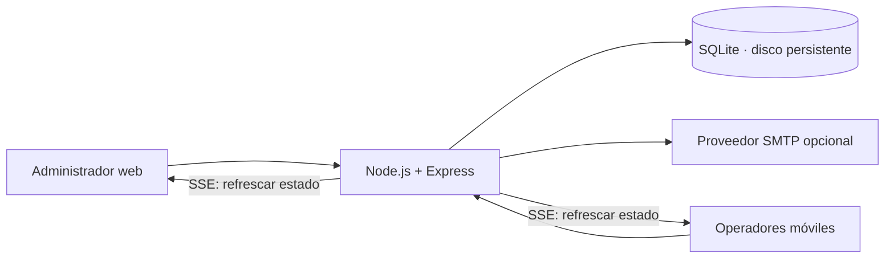

# Arquitectura del MVP

## Diseño



La interfaz HTML/CSS/JavaScript y la API se sirven desde el mismo origen. La elección evita configurar varios servicios para la primera demostración. SQLite está **en el servidor**, nunca en el celular. WAL y una espera máxima de bloqueo de 5 segundos acompañan la actualización atómica de ingreso.

Objetivo inicial: un proceso Node, un disco persistente, varios navegadores. No desplegar como función efímera ni escalar a réplicas independientes con archivos SQLite distintos. El canal SSE es local al proceso: para múltiples procesos se necesitarán PostgreSQL y un mecanismo compartido de publicación de cambios.

## Modelo

- `users`: cuenta, hash scrypt y rol.
- `sessions`: credencial aleatoria, usuario y expiración de 12 horas.
- `events`: nombre, fecha ISO con zona horaria y lugar.
- `guests`: evento, nombre, correo, RUT, empresa, token, fecha de alta, acreditación, operador, método y estado de invitación.
- `email_deliveries`: historial de intentos de envío con destinatario y nombre al enviar, remitente, asunto, fechas, estado, administrador solicitante e ID del mensaje cuando el proveedor lo devuelve. No almacena el cuerpo HTML, el QR ni credenciales SMTP.

Restricciones: email único por evento; RUT no vacío único por evento; token único global. El token usa 32 bytes aleatorios. No hay secuencias predecibles de QR. El formato escaneado es `EVT:<event_id>:<token>`.

## Concurrencia e idempotencia

El ingreso se escribe con una sola sentencia:

```sql
UPDATE guests
SET checked_at = ?, checked_by = ?, checkin_method = ?
WHERE id = ? AND event_id = ? AND checked_at IS NULL;
```

Solo una solicitud puede modificar la fila. Las siguientes reciben HTTP 409 y la hora original. Leer primero el invitado permite validar el evento y mostrar su nombre; la condición SQL, no esa lectura previa, decide si el ingreso fue aceptado. La acreditación manual usa la misma operación.

La aplicación no admite deshacer acreditaciones en el MVP. Una pérdida de respuesta de red puede dejar el ingreso ya confirmado: al reintentar se obtiene “YA INGRESÓ”, sin duplicar el registro.

## Sesiones y permisos

Cookies HttpOnly/SameSite Strict y Secure en producción; sesiones persistentes con expiración; cierre de sesión revoca la credencial. Las mutaciones exigen encabezado propio y validan Origin cuando está presente. No se habilita CORS. Helmet aplica cabeceras de seguridad; el acceso tiene límite de intentos. Las consultas usan parámetros y la interfaz escapa texto ingresado por usuarios.

Solo el administrador puede extraer QR, editar invitados, importar, enviar invitaciones y exportar. El operador puede buscar y acreditar en todos los eventos de la instalación. No se acepta un QR como autenticación de operador. Las claves iniciales se cargan desde `.env`; al reiniciar se actualiza el hash de esas dos cuentas.

## Tiempo real

`GET /api/live` mantiene una conexión SSE autenticada con latidos cada 15 segundos. Tras cada cambio envía una señal sin datos personales; el navegador consulta las listas/totales actuales. Al reconectarse vuelve a consultar el estado. La interfaz indica desconexión. Este mecanismo es apropiado para el ensayo; grandes listados requieren paginación y cambios incrementales.

## Importación y correo

Importación en memoria, solo administradores, máximo 2 MB comprimidos y 1.000 invitados. ExcelJS lee la primera hoja `.xlsx`; CSV acepta coma o punto y coma. Se validan todas las filas antes de una transacción. Se omiten duplicados sin sobrescribir registros existentes. No se admite `.xls` antiguo; guardar como `.xlsx` o CSV. El límite de tamaño comprimido no garantiza un límite de memoria descomprimida: antes de permitir archivos de fuentes no confiables, aislar el procesamiento y limitar expansión/tiempo.

La plantilla compartida `src/invitation.js` genera vista previa y correo con los datos escapados. La vista previa autenticada usa una imagen embebida y un iframe sin permisos; SMTP usa la misma imagen adjunta mediante CID. El QR se entrega directamente en la invitación inicial y mantiene el mismo token al visualizarlo y enviarlo. No hay un formulario público ni una fase de confirmación previa.

La reserva del envío y la creación de su registro histórico se realizan en una sola transacción, antes de contactar al proveedor. El estado final del invitado y del intento se actualizan juntos. Los cambios posteriores del correo del invitado no alteran los destinatarios históricos. La ficha y el reporte de correos requieren administrador.

El envío SMTP es individual. La transición `pending/failed → sending` evita envíos simultáneos; al aceptar SMTP se registra `sent`, ante error `failed`. Una caída del proceso durante el envío puede dejar `sending`; debe revisarse el proveedor antes de corregirlo manualmente. Un timeout SMTP puede ser ambiguo y un reintento podría duplicar el correo. Una siguiente fase debe usar cola e identificadores de proveedor. No se afirma entrega ni lectura.

## Evolución

El esquema se actualiza mediante `src/migrations.js`. La migración v2 añade `created_at`, un trigger de fecha para nuevos invitados y `email_deliveries` dentro de una transacción. Conserva QR, invitados, estados e ingresos existentes. Las filas antiguas conservan fecha de alta desconocida (`NULL`); no se inventan fechas ni envíos históricos. Reabrir una base v2 no repite la migración. Cambios futuros necesitan nuevas migraciones versionadas; no confiar en `CREATE TABLE IF NOT EXISTS` para actualizar columnas. Antes del uso operativo: copias verificadas, cuentas individuales, HTTPS, pruebas de dispositivos y carga, monitoreo y política de retención. No registrar contraseñas, tokens QR ni listados en logs.

## Referencias técnicas

- [SQLite en Node.js](https://nodejs.org/api/sqlite.html)
- [Seguridad de Express](https://expressjs.com/en/advanced/best-practice-security/)
- [Escáner html5-qrcode](https://github.com/mebjas/html5-qrcode)

ExcelJS depende de una versión antigua de `uuid`: `package.json` reemplaza esa dependencia por la rama 11.1.1 o superior compatible con CommonJS; la lectura/escritura XLSX se verifica en las pruebas. Mantener el archivo de bloqueo y revisar compatibilidad al actualizar.
