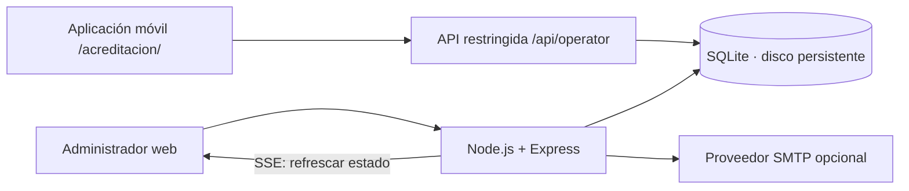

# Arquitectura del MVP

## Diseño



El panel administrador y la aplicación de operarios tienen HTML/CSS/JavaScript y APIs separados, servidos desde el mismo origen en este MVP. La elección evita configurar varios servicios para la primera demostración. SQLite está **en el servidor**, nunca en el celular. WAL y una espera máxima de bloqueo de 5 segundos acompañan la actualización atómica de ingreso.

Objetivo inicial: un proceso Node, un disco persistente, varios navegadores. No desplegar como función efímera ni escalar a réplicas independientes con archivos SQLite distintos. El canal SSE es local al proceso: para múltiples procesos se necesitarán PostgreSQL y un mecanismo compartido de publicación de cambios.

El despliegue en `test.registroevento.cl` usa un servidor exclusivo con Compose: Caddy publica HTTPS y Node queda en la red privada, con SQLite en un volumen persistente. `TRUST_PROXY=1` confía exactamente en un salto; Caddy reemplaza `X-Forwarded-For` por la IP real de su conexión. No añadir más proxies ni publicar el puerto Node sin revisar esta frontera. `/healthz` comprueba la base sin revelar datos. El respaldo diario usa la API SQLite, convierte la copia a un archivo independiente sin WAL y verifica su integridad.

## Modelo

- `users`: cuenta, hash scrypt y rol.
- `sessions`: credencial aleatoria, usuario y expiración de 12 horas; cookies separadas y validación de rol en cada aplicación.
- `operator_events`: eventos habilitados para cada cuenta de operario.
- `events`: nombre, fecha ISO con zona horaria y lugar.
- `guests`: evento, nombre, correo, RUT, empresa, token, fecha de alta, acreditación, operador, método y estado de invitación.
- `email_deliveries`: historial de intentos de envío con destinatario y nombre al enviar, remitente, asunto, fechas, estado, administrador solicitante e ID del mensaje cuando el proveedor lo devuelve. No almacena el cuerpo HTML, el QR ni credenciales SMTP.

Restricciones: email único por evento; RUT no vacío único por evento; token único global. El token usa 32 bytes aleatorios. No hay secuencias predecibles de QR. El formato escaneado es `EVT:<event_id>:<token>`.

## Concurrencia e idempotencia

El ingreso se escribe con una sola sentencia:

```sql
UPDATE guests
SET checked_at = ?, checked_by = ?, checkin_method = ?
WHERE id = ? AND event_id = ? AND checked_at IS NULL;
```

Solo una solicitud puede modificar la fila. Las siguientes reciben HTTP 409 y la hora original. Leer primero el invitado permite validar el evento y mostrar su nombre; la condición SQL, no esa lectura previa, decide si el ingreso fue aceptado. La acreditación manual usa la misma operación.

La aplicación no admite deshacer acreditaciones en el MVP. Una pérdida de respuesta de red puede dejar el ingreso ya confirmado: al reintentar se obtiene “YA INGRESÓ”, sin duplicar el registro.

## Sesiones y permisos

Cookies HttpOnly/SameSite Strict y Secure en producción; sesiones persistentes con expiración; cierre de sesión revoca la credencial. Las mutaciones exigen encabezado propio y validan Origin cuando está presente. No se habilita CORS. Helmet aplica cabeceras de seguridad; el acceso tiene límite de intentos. Las consultas usan parámetros y la interfaz escapa texto ingresado por usuarios.

Solo el administrador puede extraer QR, editar invitados, importar, enviar invitaciones y exportar. El operario solo puede buscar y acreditar en eventos de `operator_events`. Las rutas `/api/operator/*` tienen su propio inicio de sesión y cookie `eventos_operator_session`, limitada a `/api/operator`. Las demás rutas `/api/*` requieren administrador. Intercambiar o renombrar cookies no permite saltar la validación de rol. No se comparten sesiones entre aplicaciones ni existe una ruta de acreditación dentro de la API administrativa. No se acepta un QR como autenticación de operador. Las claves iniciales se cargan desde `.env`; al reiniciar se actualiza el hash de esas dos cuentas.

## Tiempo real

`GET /api/live` mantiene una conexión SSE autenticada con latidos cada 15 segundos. Tras cada cambio envía una señal sin datos personales; el navegador consulta las listas/totales actuales. Al reconectarse el panel vuelve a consultar el estado. El operario no accede a este canal administrativo: su aplicación consulta eventos asignados y búsquedas activas cada 15 segundos, sin descargar listados completos. Toda búsqueda y acreditación comprueba el permiso en el servidor, por lo que una revocación se aplica a la siguiente solicitud. La interfaz indica desconexión. Este mecanismo es apropiado para el ensayo; grandes listados requieren paginación y cambios incrementales.

## Importación y correo

Importación en memoria, solo administradores, máximo 2 MB comprimidos y 1.000 invitados. ExcelJS lee la primera hoja `.xlsx`; CSV acepta coma o punto y coma. Se validan todas las filas antes de una transacción. Se omiten duplicados sin sobrescribir registros existentes. No se admite `.xls` antiguo; guardar como `.xlsx` o CSV. El límite de tamaño comprimido no garantiza un límite de memoria descomprimida: antes de permitir archivos de fuentes no confiables, aislar el procesamiento y limitar expansión/tiempo.

La plantilla compartida `src/invitation.js` genera vista previa y correo con los datos escapados. La vista previa autenticada usa una imagen embebida y un iframe sin permisos; SMTP usa la misma imagen adjunta mediante CID. El QR se entrega directamente en la invitación inicial y mantiene el mismo token al visualizarlo y enviarlo. No hay registro previo obligatorio; la confirmación opcional se gestiona con un enlace separado del QR.

La reserva del envío y la creación de su registro histórico se realizan en una sola transacción, antes de contactar al proveedor. El estado final del invitado y del intento se actualizan juntos. Los cambios posteriores del correo del invitado no alteran los destinatarios históricos. La ficha y el reporte de correos requieren administrador.

El adaptador SMTP admite envíos individuales y una cola persistente que los procesa secuencialmente. La transición `pending/failed → sending` evita envíos simultáneos; al aceptar SMTP se registra `sent`, ante error `failed`. Una caída del proceso durante el envío puede dejar `sending`; debe revisarse el proveedor antes de corregirlo manualmente. Un timeout SMTP puede ser ambiguo y un reintento podría duplicar el correo. Una siguiente fase debe usar cola e identificadores de proveedor. No se afirma entrega ni lectura.

## Evolución

El esquema se actualiza mediante `src/migrations.js`. La migración v2 añade `created_at`, un trigger de fecha para nuevos invitados y `email_deliveries` dentro de una transacción. Conserva QR, invitados, estados e ingresos existentes. Las filas antiguas conservan fecha de alta desconocida (`NULL`); no se inventan fechas ni envíos históricos. La migración v3 añade `operator_events` sin asignar permisos automáticamente a eventos existentes y revoca las sesiones antiguas de operarios; conserva las de administración. Reabrir una base v3 no repite las migraciones. Cambios futuros necesitan nuevas migraciones versionadas; no confiar en `CREATE TABLE IF NOT EXISTS` para actualizar columnas. Antes del uso operativo: copias verificadas, cuentas individuales, HTTPS, pruebas de dispositivos y carga, monitoreo y política de retención. No registrar contraseñas, tokens QR ni listados en logs.

## Referencias técnicas

- [SQLite en Node.js](https://nodejs.org/api/sqlite.html)
- [Seguridad de Express](https://expressjs.com/en/advanced/best-practice-security/)
- [Escáner html5-qrcode](https://github.com/mebjas/html5-qrcode)

ExcelJS depende de una versión antigua de `uuid`: `package.json` reemplaza esa dependencia por la rama 11.1.1 o superior compatible con CommonJS; la lectura/escritura XLSX se verifica en las pruebas. Mantener el archivo de bloqueo y revisar compatibilidad al actualizar.

## Contrato de acreditación móvil

`src/operator.js` expone únicamente login/logout, identidad de la cuenta, eventos asignados (id/nombre/fecha/lugar), búsqueda limitada y check-in. La búsqueda exige 2–100 caracteres, escapa comodines y devuelve como máximo 20 coincidencias con id/nombre/empresa, correo y RUT enmascarados y estado de ingreso. No devuelve tokens QR, correos de invitación, totales ni la ficha completa. El resultado de check-in contiene solo nombre y hora. `public/acreditacion/` no carga el código de administración. La búsqueda se mantiene solo en memoria, no en almacenamiento del teléfono.

El escaneo continuo mantiene abierta la cámara y la decodificación entre invitados. `busy` serializa las solicitudes sin encolarlas, y una pausa de 1,4 segundos permite leer el resultado. Se descartan detecciones consecutivas del mismo QR hasta que transcurren 1,8 segundos sin detectarlo; esto evita repeticiones del lente, pero la garantía de ingreso único sigue siendo la actualización condicional en SQLite. No se muestra éxito antes de la respuesta del servidor. Un contador de sesión de cámara invalida callbacks y temporizadores al detener, cambiar evento o esconder la página, incluidos permisos de cámara que llegan tarde. Errores de red, sesión o permisos detienen el flujo; 400/409 muestran el rechazo y permiten continuar automáticamente.

## Administración ampliada · esquema v4

Migración aditiva transaccional: `events.invitation` conserva diseño validado en JSON; `guests` añade categoría, notas, estado/fecha de confirmación y un token de confirmación aleatorio independiente (32 bytes). Se completa ese token para las filas antiguas y un trigger lo genera en altas futuras. No se altera el token QR, el ingreso ni la auditoría existente. `email_deliveries.kind` distingue pruebas de invitaciones; `email_batches` y `email_batch_items` persisten los lotes.

Las imágenes se reciben como PNG/JPEG/WebP base64, con tipo, firma y tamaño comprobados (350 KB cada una, JSON máximo 1 MB). No se aceptan SVG, HTML libre ni URL para descargar recursos en el servidor. La vista previa usa data URI; el correo adjunta las imágenes con CID. Todos los textos se escapan y los colores solo aceptan hexadecimal. La lista de eventos no incluye el JSON de imágenes para evitar transferirlo en cada refresco.

La reserva del lote y de todos sus invitados es una transacción. Solo incluye estado `pending` y una selección explícita de hasta 1.000 IDs pertenecientes al evento y categoría. Los invitados quedan `queued`; no se pueden editar hasta terminar. Tampoco se puede cambiar el diseño mientras existan envíos en cola/en proceso. Un único trabajador procesa secuencialmente. Al reiniciar se retoman solo los elementos pendientes; los elementos `sending` quedan en revisión, sin repetir el correo. Cada intento tiene auditoría. Cerrar el navegador no cancela el lote. El servidor espera al envío activo durante su cierre normal. Se mantiene un solo proceso Node; no usar varios trabajadores sobre esta cola.

El reenvío individual exige `resend: true` para un estado `sent`; no permite repetir un envío activo. Una prueba usa destinatario explícito, asunto `[PRUEBA]`, QR inválido para acceso y no incluye enlaces de confirmación. Conserva un registro con `kind=test` asociado al invitado usado como referencia, sin modificar sus estados. El historial de la pantalla muestra los últimos 500 intentos; CSV exporta todos.

`/confirmacion/?token=…` es una página pública y `/api/rsvp/:token` valida una credencial aleatoria de 64 caracteres hexadecimales. GET solo devuelve nombre de invitado y datos mínimos del evento/respuesta; no retorna QR, correo, notas ni listas. POST exige la protección de origen/encabezado y una elección `yes/no`. El enlace no cambia estados por GET (evita respuestas accidentales por previsualizadores de correo). La página aplica `no-referrer` y la API `no-store`. La confirmación no modifica `checked_at`; declinar no invalida el pase. Cambiar el correo rota el token de confirmación y reinicia su respuesta.

La restricción de acreditación SQL condicional y las rutas de operarios permanecen sin modificaciones.
